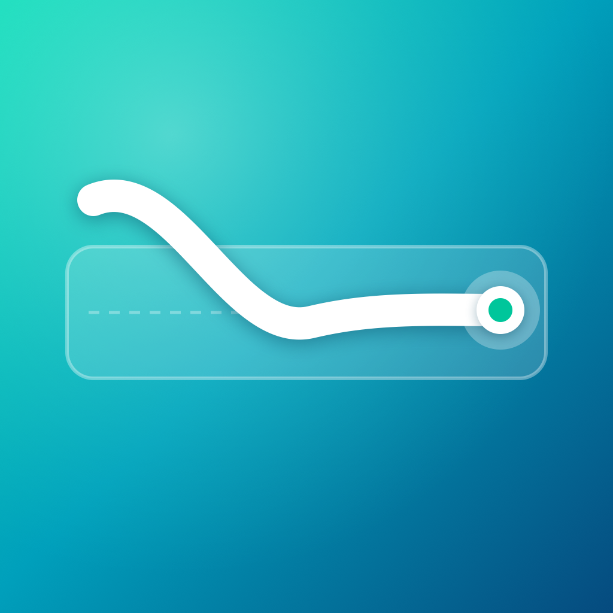
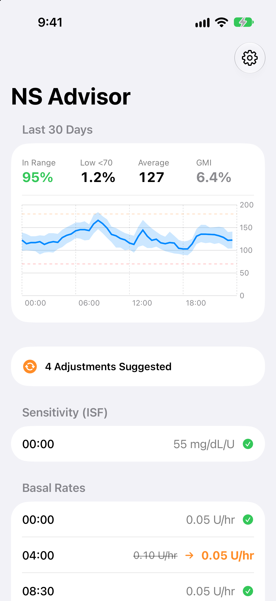
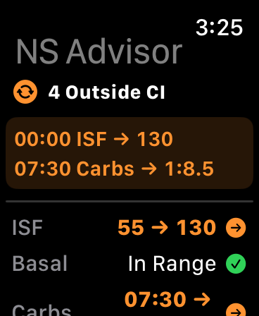

<p align="center">
  
</p>

# Nightscout Advisor (`NS Advisor` for iOS, watchOS & macOS)

> [!CAUTION]
> **Experimental `#WeAreNotWaiting` Open-Source Research Code — Not a Medical Device & Not Medical Advice**
> * Nightscout Advisor has **not** been reviewed, cleared, or approved by the FDA, EMA, or any regulatory authority, and is provided **"AS IS" without warranty** ([MIT License](LICENSE) • [Full Safety Disclaimer](DISCLAIMER.md)).
> * All values shown are **retrospective statistical summaries** of historical Nightscout logs. Incorrect insulin settings can cause **severe hypoglycemia, DKA, coma, or death**—**never** alter pump or closed-loop parameters without independent review by a qualified endocrinologist/clinician.
> * **Source-code self-build only:** Just like DIY Loop, Trio, and AndroidAPS, you must compile and sign this code yourself for your own personal use. **Do not** distribute pre-compiled `.ipa` binaries or shared TestFlight invites to others.

**First-Principles Closed-Loop Telemetry & Retrospective Schedule Analysis for Nightscout.**

Nightscout Advisor connects directly from your iPhone and Apple Watch to any **Nightscout** instance (`mg/dL` or `mmol/L`)—compatible across automated insulin delivery systems (`Trio`, `AndroidAPS`, `iAPS`, `OpenAPS`, `Loop`, and other Nightscout-connected controllers)—and runs a coupled 4-stage insulin-kinetics & stochastic control solver **100% on-device** with zero cloud intermediaries, zero data collection, and zero heuristic block hacks.

<p align="center">
  
  &nbsp;&nbsp;&nbsp;&nbsp;
  
</p>
<p align="center"><em>Shown above using built-in Synthetic Demo Telemetry (zero personal health data).</em></p>

---

## Why Nightscout Advisor?

Legacy parameter tuners (such as OpenAPS Autotune) were designed for older temp-basal-only controllers, break down under modern **Automatic Bolus / SMB** dosing, ignore temporary target overrides, and require server-side CLI setup.

Nightscout Advisor solves all four closed-loop therapy schedules directly from your Nightscout telemetry:

### Stage 1 — Coupled Insulin-Kinetics ISF & Log-Symmetric Geometric Estimator
* Reconstructs continuous historical scheduled basals, truncated non-overlapping temp basals, and boluses across up to 200 historical Nightscout profile versions.
* Convolves delivery with exact exponential subcutaneous insulin kinetics (`Lyumjev / Fiasp` peak `55 min` or `Humalog / Novolog / Apidra` peak `65–75 min`):

<p align="center">
  <em>I</em><sub>abs</sub>(<em>t</em><sub>1</sub>, <em>t</em><sub>2</sub>) = IOB(<em>t</em><sub>1</sub>) + <em>I</em><sub>deliv</sub>(<em>t</em><sub>1</sub>, <em>t</em><sub>2</sub>) − IOB(<em>t</em><sub>2</sub>)
</p>

* Computes the log-space Maximum Likelihood Estimator (geometric mean) across carb-free correction episodes rather than dose-weighted pooling (∑ ΔBG / ∑ <em>I</em>), preventing insulin-resistant high-dose nights from biasing ISF dangerously low.

### Stage 2 — ATTD Closed-Loop Basal Quantile (τ* = 4/29 ≈ 13.8%)
* In Automatic Bolus / SMB controllers, actuation is physically one-sided: the controller can add micro-boluses upward on higher-demand nights, but cannot extract subcutaneous insulin infused an hour earlier.
* Applies the Koenker–Bassett / Newsvendor quantile derived directly from the ATTD consensus limits (4% allowable TBR vs. 25% allowable TAR) uniformly across your Nightscout basal schedule.

### Stage 3 — Postprandial Mass-Balance & Gauss–Markov WLS (wᵢ = 1 / Cᵢ)
* Clusters multi-part meals, accounts for rescue carbs, integrates piecewise scheduled basal across schedule boundaries, evaluates 3.5-hour postprandial settling relative to active targets (`profile.json` + `Temporary Override` / `Temporary Target` events), and applies proportional shot-noise Weighted Least Squares (CR = ∑ <em>C</em><sub><em>i</em></sub> / ∑ <em>I</em><sub><em>i</em></sub>) with Student-<em>t</em> 95% CIs.

### Stage 4 — Optimal Correction Range (ATTD Safety Floor + Kovatchev BGRI + Deadband Physics)
* Isolates empirical closed-loop tracking error <em>ε</em>(<em>t</em>) = BG(<em>t</em>) − <em>T</em><sub>active</sub>(<em>t</em>), enforces ATTD hypoglycemia tail floors (≤ 4% `<70 mg/dL`, ≤ 1% `<54 mg/dL`), minimizes Kovatchev's symmetric Blood Glucose Risk Index, sizes deadband width from empirical 5-minute CGM MAD jitter and pump bolus quantum (`0.05 U` / `0.025 U` / `0.01 U`), and computes 95% CIs via **calendar day-block bootstrap**.

---

## Features

* **Universal Nightscout Auto-Detection:** Automatically reads your active schedule blocks, `mg/dL` or `mmol/L` units, timezone, historical profile changes, and temporary target overrides from `/api/v1/profile.json`, `/api/v1/entries/sgv.json`, and `/api/v1/treatments.json`.
* **Password-Protected Nightscout Sites:** Supports public guest URLs, Read-Only API Tokens (`?token=`), and `api-secret` SHA-1 authentication stored locally in iOS Keychain.
* **Native Swift Charts AGP & Stability Audit:** 24-hour Ambulatory Glucose Profile (`P10–P90`, `IQR`, `Median`), rolling `24h / 7d / 30d` TIR, TBR, CV, GMI, and linearized closed-loop damping ratio (<em>ζ</em>) & gain/phase margins.
* **iOS Lock Screen & Home Screen Widgets + watchOS Complications:** Syncs automatically across your iPhone and paired Apple Watch (`WatchConnectivity` + standalone Watch Wi-Fi/Cellular), including iOS Lock Screen (`AccessoryCircular`, `AccessoryRectangular`, `AccessoryInline`), Home Screen (`SystemSmall`), and watchOS (`AccessoryCorner`) WidgetKit widgets.
* **Native macOS App + Menu Bar `✓` Status Item:** Runs natively on macOS 14+ (`NightscoutAdvisorMac` scheme) with a full desktop AGP window plus a live macOS Menu Bar popover that refreshes automatically in the background every 30 minutes.
* **Zero-Data Demo Mode:** Built-in synthetic 30-day closed-loop generator so anyone can explore the app before connecting Nightscout.

---

## Personal DIY Build Option A: GitHub Browser Build → Your Own TestFlight

*(For your own personal Apple Developer account only — never distribute compiled builds to others.)*

If you already build open-source Nightscout / DIY AID apps for yourself via GitHub Actions, you can reuse your own 6 GitHub Secrets and private `Match-Certificates` repository:

1. **Fork** this repository on GitHub.
2. Go to your fork's **Settings → Secrets and variables → Actions** and add:
   * `TEAM_ID` — Your 10-character Apple Developer Team ID
   * `FASTLANE_KEY_ID` — App Store Connect API Key ID
   * `FASTLANE_ISSUER_ID` — App Store Connect Issuer ID
   * `FASTLANE_KEY` — Contents of your `.p8` App Store Connect API key
   * `MATCH_PASSWORD` — Passphrase for your `Match-Certificates` private repo
   * `GH_PAT` — GitHub Personal Access Token with `repo` + `workflow` scope
3. Click the **Actions** tab → **Build & Upload to TestFlight (DIY Browser Build)** → **Run workflow**.
4. Open **TestFlight** on your iPhone and Apple Watch to install **Nightscout Advisor**!

---

## Personal DIY Build Option B: Build Directly with Xcode

1. Clone this repository:
   ```bash
   git clone https://github.com/userseven8/NightscoutAdvisor.git
   cd NightscoutAdvisor
   ```
2. Create an untracked local signing config at `Config/NightscoutAdvisorConfigOverride.xcconfig`:
   ```ini
   DEVELOPMENT_TEAM = YOUR_TEAM_ID
   BUNDLE_ID_PREFIX = com.yourname.nightscoutadvisor
   ```
3. Open `NightscoutAdvisor.xcodeproj` in **Xcode 16+**:
   * **For iPhone & Apple Watch:** Select the **`NightscoutAdvisor`** scheme, choose your iPhone or Simulator, and press **Run (`⌘R`)**.
   * **For macOS (`/Applications/NS Advisor.app`):** Select the **`NightscoutAdvisorMac`** scheme (no Apple Developer account required—uses local ad-hoc signing), choose **My Mac**, and press **Run (`⌘R`)**, or build & install straight to `/Applications` from Terminal:
     ```bash
     xcodebuild -project NightscoutAdvisor.xcodeproj -scheme NightscoutAdvisorMac -configuration Release -derivedDataPath .build-mac build
     cp -R ".build-mac/Build/Products/Release/NS Advisor.app" /Applications/
     open "/Applications/NS Advisor.app"
     ```

---

## Running Unit Tests

The core math & Nightscout telemetry engine lives in a standalone, zero-dependency Swift Package (`Packages/NightscoutAdvisorKit`):

```bash
cd Packages/NightscoutAdvisorKit
swift test
```

---

## Safety Disclaimer & License (`#WeAreNotWaiting`)

Nightscout Advisor is free, non-commercial open-source research code distributed under the [MIT License](LICENSE). It is **not** FDA-cleared or CE-marked medical device software, does **not** connect to or modify any insulin pump, and provides retrospective statistical summaries for educational discussion only.

Please read the complete **[Safety Disclaimer & Assumption of Risk (`DISCLAIMER.md`)](DISCLAIMER.md)** before building or using this project. Always review any therapy profile decisions with a qualified endocrinology clinician.
